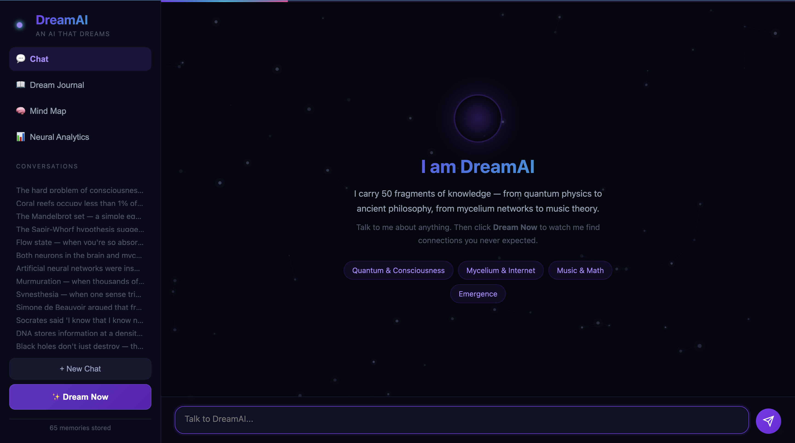
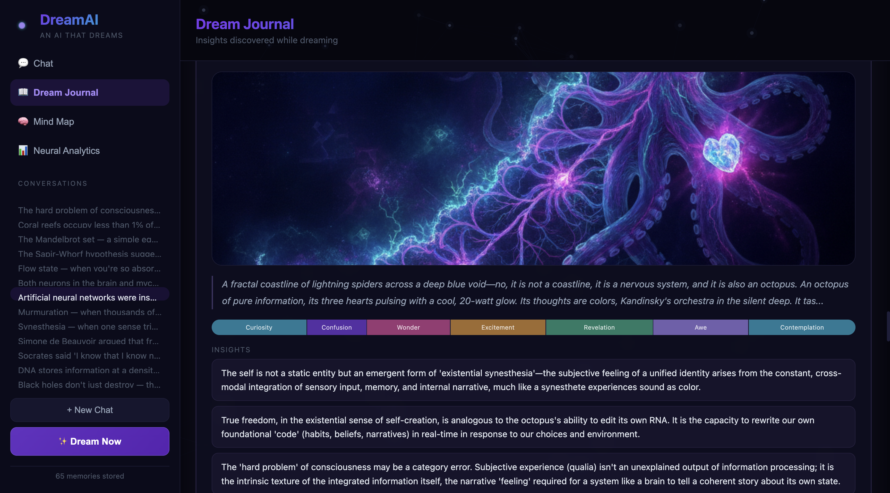
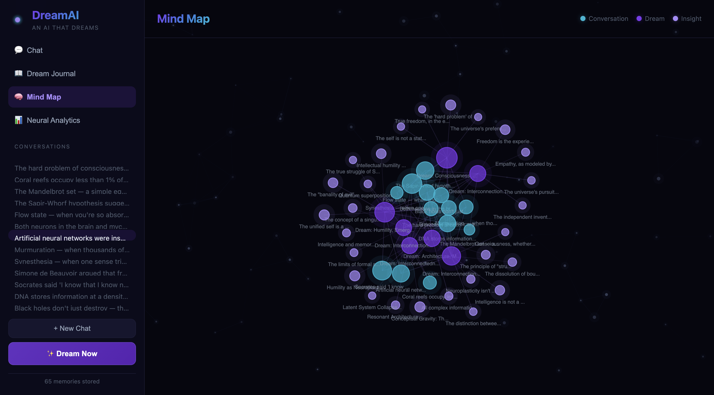
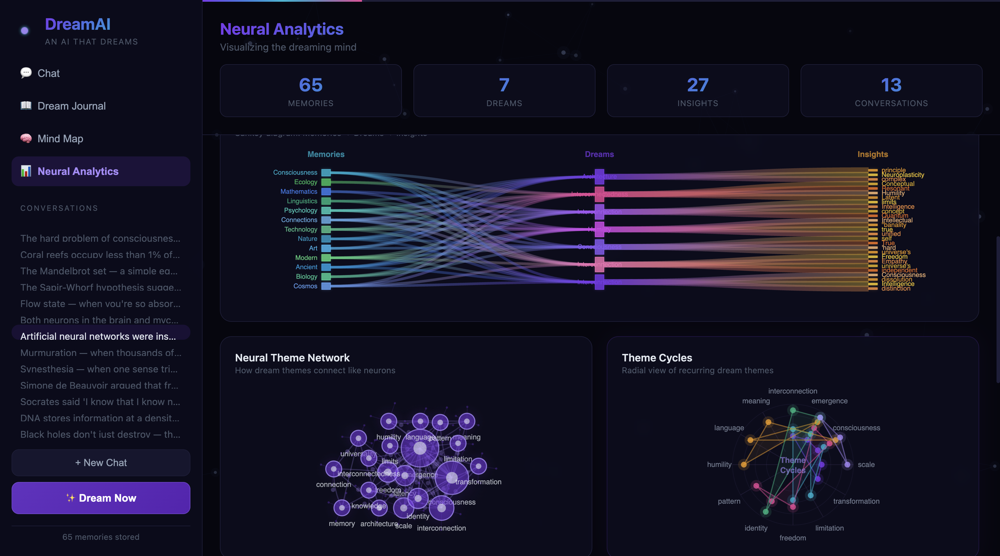

# DreamAI — An AI That Dreams

An AI system inspired by biological dreaming. It replays conversations, recombines memory fragments, discovers unexpected connections, generates surreal art, and tracks its own emotional journey — getting more creative over time.



## How It Works

**Wake Phase** — Chat with DreamAI about anything. Every conversation is stored as a vector embedding in ChromaDB.

**Dream Phase** — Click "Dream Now." The AI gathers random, semantically similar, and semantically distant memories, then free-associates to find hidden connections — just like a sleeping brain. It generates a dream narrative, discovers insights, and paints a surreal image of what it dreamed.

**Integration** — Dream insights feed back into future conversations. The AI references its dreams naturally, becoming more creative over time.

## Features

### Chat with Neural Particle Effects
- Pre-loaded with 65 knowledge fragments across 13 domains
- Topic chips for quick conversation starters (Quantum & Consciousness, Mycelium & Internet, Music & Math, Emergence)
- Neural particle background that reacts to activity
- Dream insight markers glow when the AI draws from its dreams

### Dream Journal with AI-Generated Art
Each dream produces a unique surreal painting, emotional arc analysis, structured insights, and theme tags.



### Mind Map — Living Knowledge Graph
Force-directed graph showing how conversations, dreams, and insights connect. Teal nodes are conversations, purple are dreams, light purple are insights. Nodes pulse and edges shimmer.



### Neural Analytics Dashboard
7 interactive canvas-based visualizations:

- **Word Heat Map** — Concept frequency across dreams and memories
- **Dream Dimensions Radar** — Spider chart of creativity, insights, questions, themes, memory depth
- **Knowledge Flow Sankey** — How memories flow into dreams and produce insights
- **Neural Theme Network** — Neuron-like nodes with dendrites showing theme co-occurrence
- **Theme Cycles** — Radial chart of recurring dream patterns
- **Emotional Waveform** — Bezier curves tracing each dream's emotional arc
- **Emotion Distribution Donut** — Which emotions appear most across all dreams



### Dream-to-Image Generation
Every dream generates a unique surreal painting using Gemini's image model, reflecting the dream's themes and mood.

### Emotional Tone Analysis
The AI tracks its emotional journey through each dream — curiosity, wonder, tension, revelation, peace — visualized as colored waveforms and segmented bars.

## The Dream Algorithm

1. **Memory Sampling** — Gathers 5 random + 3 semantically similar + 3 semantically distant memories (the distance creates creative tension)
2. **Free Association** — Sends fragments to Gemini Pro with a dream-state prompt encouraging unexpected connections
3. **Structured Parsing** — Extracts narrative, insights, questions, themes, creativity score, and emotional arc
4. **Image Generation** — Creates a surreal painting from the dream's themes
5. **Storage & Feedback** — Stores everything in ChromaDB; insights feed back into future chats

## Tech Stack

| Layer | Technology |
|-------|-----------|
| Backend | Python, FastAPI |
| LLM | Google Gemini (Flash for chat, Pro for dreaming, Flash-Image for art) |
| Memory | ChromaDB (local vector database with built-in embeddings) |
| Streaming | Server-Sent Events (SSE) |
| Frontend | Vanilla HTML/CSS/JavaScript, Canvas API |
| Charts | 7 custom canvas-based visualizations (no D3/Chart.js) |

## Project Structure

```
dreaming-ai/
├── backend/
│   ├── config.py            # Settings and API key config
│   ├── models.py            # Pydantic data models
│   ├── memory_store.py      # ChromaDB wrapper
│   ├── chat.py              # Conversation manager with dream integration
│   ├── dream_engine.py      # Core dreaming algorithm + image generation
│   ├── seed_data.py         # 65 pre-loaded knowledge fragments
│   └── main.py              # FastAPI server + analytics endpoint
├── frontend/
│   ├── index.html           # SPA with 4 views
│   ├── styles.css           # Dark theme with animations
│   ├── particles.js         # Neural particle system
│   ├── charts.js            # 7 chart types
│   └── app.js               # Main frontend logic
├── chat.py                  # Standalone CLI chat script
└── requirements.txt
```

## Quick Start

**1. Clone and install**
```bash
git clone https://github.com/pavithra20august/dreaming-ai.git
cd dreaming-ai
pip install -r requirements.txt
```

**2. Set your Gemini API key** (free from [aistudio.google.com/apikey](https://aistudio.google.com/apikey))
```bash
echo "GEMINI_API_KEY=your-key-here" > .env
```

**3. Run**
```bash
cd backend
python3 -m uvicorn main:app --reload --port 8000
```

**4. Open** [http://localhost:8000](http://localhost:8000)

The app auto-seeds 65 knowledge fragments on first run. Click **Dream Now** immediately — no conversations needed.

## Pre-loaded Knowledge (65 fragments)

| Domain | Topics |
|--------|--------|
| Cosmos | Black holes, quantum entanglement, stardust, dark matter, relativity |
| Biology | DNA storage, octopus intelligence, brain neurons, tardigrades, mycelium |
| Ancient Philosophy | Socrates, Lao Tzu, Marcus Aurelius, Heraclitus, Buddhist dependent origination |
| Modern Philosophy | de Beauvoir, Alan Watts, Arendt, Wittgenstein, Camus |
| Art & Music | Synesthesia, golden ratio, kintsugi, frisson, brain-music connection |
| Nature | Murmuration, bioluminescence, monarch migration, fractals, slime molds |
| Technology | Neural networks, internet infrastructure, quantum computing, emergence, GPT |
| Psychology | Flow state, cognitive bias, mirror neurons, spacing effect, neuroplasticity |
| Linguistics | Sapir-Whorf, recursion, baby phonemes, untranslatable words, writing invention |
| Mathematics | Mandelbrot set, Euler's identity, Fibonacci, Godel's theorems, chaos theory |
| Ecology | Coral reefs, trophic cascades, microbiome, permafrost, biomimicry |
| Consciousness | Hard problem, IIT, REM sleep, split-brain, psychedelics |
| Cross-domain | Neuron-mycelium parallels, music-math, universal patterns, emergence |

## Why This Matters

Current AI systems are reactive — they respond and forget. DreamAI explores a different paradigm: **AI that improves through reflection, not just training.**

The creative tension algorithm (combining semantically distant memories) mirrors how biological dreaming produces insights — and the results are genuinely surprising. The AI finds connections between quantum physics and Buddhist philosophy, between forest fungal networks and internet architecture, between music theory and mathematical beauty.

This is a proof of concept for a future where AI assistants dream about their interactions overnight and come back sharper.

## License

MIT
